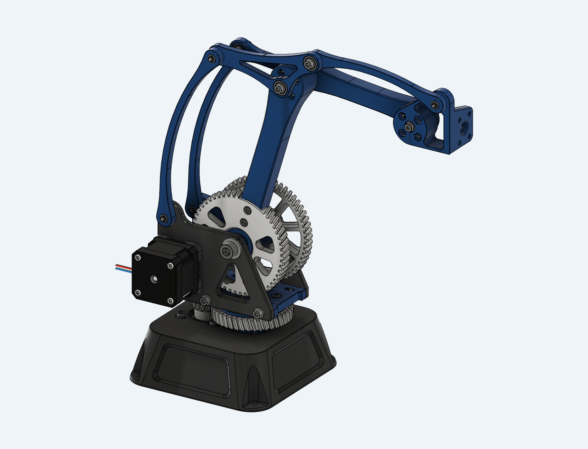

# Printabot · Brazo robótico V2

Brazo robótico antropomórfico DIY con **tres grados de libertad**, tres motores NEMA 17 y una estructura pensada para impresión 3D FDM. El eje lineal queda reservado para una versión posterior.

## Arquitectura mecánica

| Eje | Movimiento | Accionamiento |
| --- | --- | --- |
| M0 | Giro del brazo sobre el eje vertical | NEMA 17 en el pedestal, piñón y rueda de giro |
| M1 | Inclinación del eslabón inferior L1 | NEMA 17 en la plataforma giratoria y engranaje del hombro |
| M2 | Inclinación del eslabón superior L2 | NEMA 17 en la misma plataforma, engranaje secundario y transmisión por bieletas |

Los paralelogramos transmiten el movimiento desde la base hasta el codo y la brida terminal. L1 y L2 tienen accionamientos independientes y la aplicación controla sus inclinaciones respecto al suelo. El codo y la brida tienen pivotes pasivos, y los motores se concentran en el pedestal y la plataforma. Las bieletas y los engranajes pueden interferir entre sí en ciertas posturas, por lo que el rango útil depende de la combinación de ángulos.

Documentación en desarollo.

